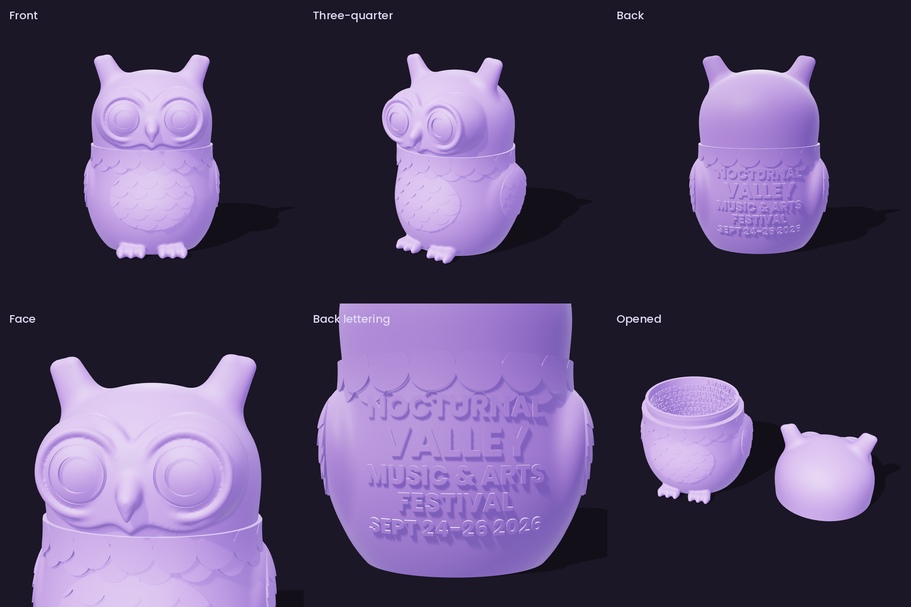
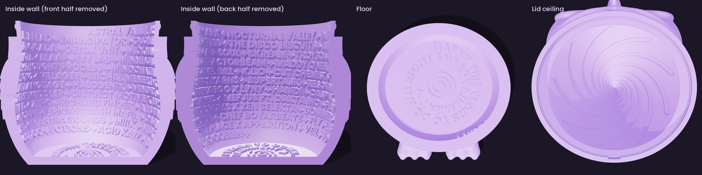

# Nocturnal Valley Pocket Owl Box

A pocket-sized, 3D-printable owl trinket box made for **Nocturnal Valley Music & Arts Festival 2026** (September 24-26, Astral Valley Art Park, French Village, MO). The head is the lid, the body is the box, and the inside is covered in hidden lettering: a ten-year dedication on the floor and 54 artists from the lineup spiraling around the wall.



> Unofficial fan-made design. Not affiliated with or endorsed by Nocturnal Valley, Down Right Entertainment, or Astral Valley Art Park. Artist names appear as a tribute and belong to their owners. The owl is an original sculpt, not the festival poster artwork.

## What's in it

**Outside**
- Big round eyes with pupils and catchlights, a heart-shaped face, and short blunt ear tufts
- Overlapping feathers on the chest and wings, and a feather collar that hides the lid seam
- Raised lettering on the back: NOCTURNAL VALLEY / MUSIC & ARTS FESTIVAL / SEPT 24-26 2026
- Nothing sticks out far enough to snap off in a pocket

**Inside**
- **Floor:** HAPPY TEN YEARS TO DOWN RIGHT ENTERTAINMENT, spiraling into a hypno swirl
- **Wall:** ASTRAL VALLEY ART PARK, NOCTURNAL VALLEY, then 54 artists on an 11-turn helix, headliners first. It reads left to right from inside, top to bottom.
- **Lid ceiling:** a 9-arm vortex

**The lid**
- Only fits facing forward (a small key rib at the back of the lip)
- A snap bead clicks it shut so it won't open in a pocket



## Files

| File | What it is |
| --- | --- |
| [`stl/owl_base.stl`](stl/owl_base.stl) | Body and container. Print upright on its flat bottom. |
| [`stl/owl_lid.stl`](stl/owl_lid.stl) | Head and lid. Print rim-down, exactly as exported. |
| [`source/`](source/) | The Python generator that builds both STLs from scratch, so you can make your own version. |

Assembled size is about **46 x 41 x 63 mm** (roughly a large egg), and it holds about **36 ml**.

## Printing

Tested settings for a single-color FDM print with a 0.4 mm nozzle:

| Setting | Value |
| --- | --- |
| Supports | None on either part. Every ceiling and overhang is 45 degrees or gentler. |
| Layer height | 0.12 to 0.16 mm. The inside lettering is only about 2 mm tall. |
| Wall generator | Arachne. It keeps the 0.5 mm letter strokes from being dropped. |
| Walls / infill | 3 walls, 15% infill |
| Lid | Add a 3 mm brim. It stands on a narrow rim. |
| Seam | Paint or place it on the side, under a wing, away from the face and lettering. |
| Material | PLA or PETG. A silk purple matches the poster. |

A 0.2 mm nozzle makes the inside lettering noticeably crisper.

### Tuning the fit

Printers vary, so the snap fit may need a nudge:

- **Too tight:** scale the **lid** to 100.5% in X and Y, or lightly sand the bead ring on the base lip.
- **Too loose:** scale the **lid** to 99.7% in X and Y.

## Make your own version

Everything is generated by code, so you can change the text, swap artists, or adapt it to another festival.

```bash
cd source
pip install -r requirements.txt
python build.py
```

The STLs land in `source/out/`. A full build takes under a minute and needs about 3 GB of RAM. It was tested with Python 3.13. The Poppins Bold font is bundled in `source/fonts/`, so the lettering comes out the same on any machine.

Where to change things:

| What | Where |
| --- | --- |
| Back lettering | `LINES` in `build.py` (text, size in mm, height on the body) |
| Floor dedication | `FLOOR_TXT` in `build.py` |
| Text before the lineup on the wall | `words` in `build.py` |
| Full lineup | `LINEUP` in `lineup.py` |
| Who goes first on the wall | `TOP_BILL` in `build.py`. Names are placed in order until the wall is full. Names that don't fit are skipped, and the build log lists them. |
| Overall size | `S` in `build.py`. Shrinking it makes the inside lettering harder to print. |
| Lid fit clearance | `LID_IN` and `LIP_OUT` in `build.py` (0.2 mm gap by default) |

The build also writes `out/wall_lineup.txt` with exactly which artists made it onto the wall.

### How it works

- The owl's body, head, face, tufts, wings and feet are one signed-distance field (`owl_field.py`), meshed with marching cubes so all the shapes blend smoothly into each other.
- The wall, lip, snap bead and lid recess are offset surfaces of that same field, which keeps the wall thickness even.
- Feathers and lettering are built flat, then warped onto the curved surface by ray casting, and joined with [Manifold](https://github.com/elalish/manifold) booleans. The finished parts are watertight, single solids.

<details>
<summary>Artists on the inside wall (54)</summary>

DAILY BREAD, EMANCIPATOR, G JONES, STS9, THE DISCO BISCUITS, JADE CICADA, DETOX UNIT, MICKMAN, AB-SOUL, SKREAM, TROYBOI, OTT., BLAAP, IVY LAB, MINNESOTA, TRACTORBEAM, MADDY O'NEAL, THOUGHT PROCESS, MINDCHATTER, MR. BILL, K.L.O, CUT CHEMIST, YOKO, VILLAGER, MICHAL MENERT, CHRIS KARNS, SUPERTASK, RESONANT LANGUAGE, HALOGENIX, MINDEX, PEEKABOO X LYNY, HAMDI, CASPA X THE WIDDLER, DISTINCT MOTIVE X EAZYBAKED, MEFJUS FT. DAXTA MC, FLAVA D, ZERO, RICHARD FINGER, A HUNDRED DRUMS X ZEN SELEKTA, BOMMER, BORNE, BRICKSQUASH MAFIA, CASEY CLUB, CHEF BOYARBEATZ, FLY, LUSID, MANTRA SOUNDS, MIILK, MEDICINE PLACE X APPARITION, VEIL, VOODOO, POTIONS, ACID KATZ, AUDIO GOBLIN

</details>

<details>
<summary>Artists that didn't fit (39)</summary>

The lettering is already at the limit of what a 0.4 mm nozzle can print, so these didn't make it: GRLL SMTH VS THE CRAWBOIL, CRAWDAD SNIPER, DETRE, FLINTWICK, GOOSEBUMPZ, OOGA, SCHMOOP, SOMATOAST, SUPERSILLYUS, MONTY, HIJINX, ECHO BROWN, PHEEL., PARKBREEZY, ALEX UNGER, TF MARZ, MIKE WALLIS, HUMANDALA, LONEDRUM, RESTRAINT, ALEJO, COOL CUSTOMER, ESSEKS, TIEDYE KY, DMVU, VCTRE, DUFFREY, CHMURA, ARTIFAKTS, DAGGZ, KLL SMTH, LUMASI, RHIZOMORPHIC, TWO GUYS, VIDE, VINCENT ANTONE, ANDROID JONES, GLASS CRANE, DR01D VISUALS

</details>

## License

- **3D models, images and docs:** [CC BY-NC-SA 4.0](https://creativecommons.org/licenses/by-nc-sa/4.0/). Print it, remix it and share it, with credit, for non-commercial use, and share remixes under the same terms. See [`LICENSE`](LICENSE).
- **Source code** in `source/`: MIT. See [`source/LICENSE`](source/LICENSE).
- **Poppins font:** SIL Open Font License 1.1. See [`source/fonts/OFL.txt`](source/fonts/OFL.txt).

Designed by Brett Bartrum ([@bartrumb](https://github.com/bartrumb)).
